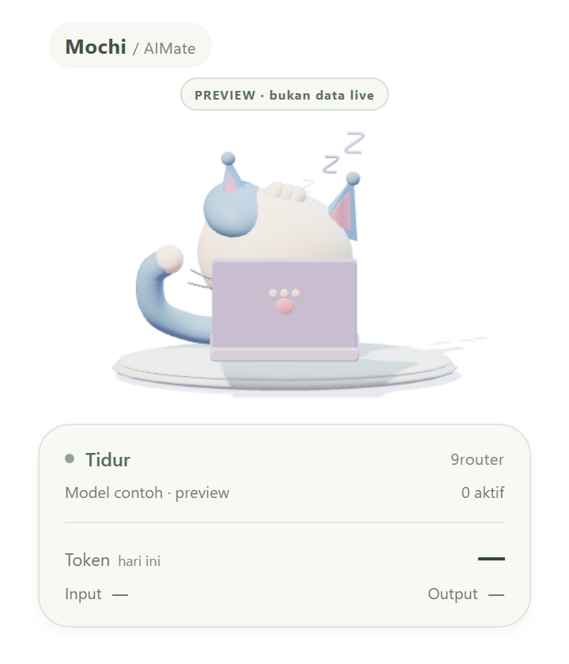
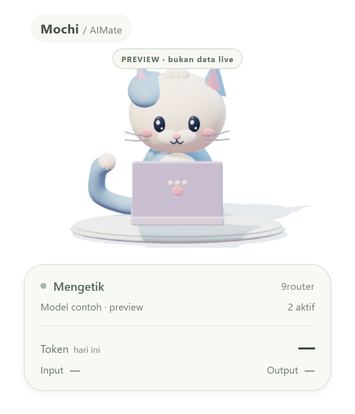
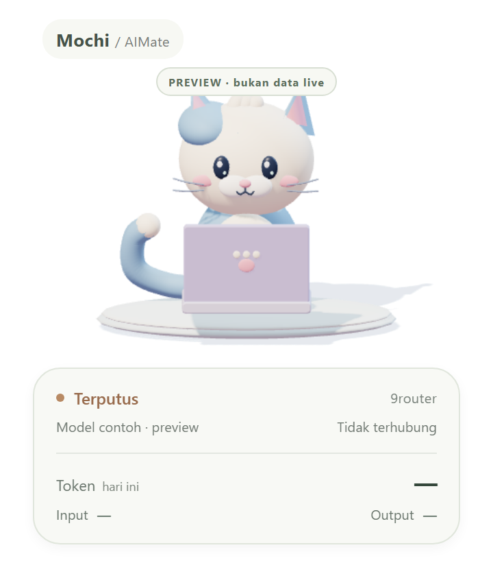

# AIMate Widget — Mochi

Desktop pet Windows transparan, always-on-top, dibuat dengan Tauri 2 + Three.js lokal. Mochi adalah karakter 3D prosedural original dengan laptop mini; SVG/CSS dipertahankan hanya sebagai fallback jika WebGL gagal. Mochi mengikuti aktivitas AI di 9router, termasuk Hermes/agent lain yang request-nya melewati router ini.

## Tampilan

**Tidur (idle)** — mata tertutup, kepala bersandar di kaki, napas lembut, simbol Z mengambang, ekor mengibas pelan.

**Mengetik (working)** — menghadap laptop, kedua kaki mengetik bergantian, ekor aktif, telinga berkedut.

**Offline** — kucing tetap terjaga menunggu koneksi 9router kembali.

## Jalankan
Klik dua kali `AIMate-Widget.exe` atau `Start AIMate.bat`. Geser melalui area karakter/header. Tombol slider membuka pengaturan; X keluar.

- Working: kaki mengetik bergantian, kode bergerak, jumlah request dan model ditampilkan.
- Idle: tidur, mata tertutup, kepala bersandar, napas lembut dan simbol Z mengambang.

Renderer ada di `ui/mochi3d.js`, Three.js 0.160.1 dan lisensi MIT dibundel dalam `ui/vendor/` tanpa CDN. Model dan animasi dibuat prosedural, bukan hasil inference UniMate atau file GLB. Renderer membatasi DPR 1.5, menargetkan 30 fps, berhenti saat jendela tersembunyi, dan menghormati reduced motion. `qa_3d.py` menguji preview lewat server HTTP lokal (ES module tidak cocok diuji lewat file://); `qa_3d_native.py` memverifikasi renderer terbundel dan IPC dalam WebView2 asli.
- Offline: indikator terputus; otomatis mencoba sambung kembali.

## Koneksi
Menggunakan SSE asli `GET /api/usage/stream`, bukan CPU, keyboard logger, atau histori sebagai perkiraan. `activeRequests[].count` dijumlahkan untuk concurrency. UI membaca cache backend setiap 900ms, tanpa request statistik berulang.

Default `http://127.0.0.1:20128`. Versi ini ditujukan ke 9router lokal di port 20128 (localhost juga diterima), bukan router remote. Kredensial CLI dibaca saat runtime dari `%APPDATA%/9router/machine-id` dan `auth/cli-secret` memakai mekanisme autentikasi CLI 9router yang terpasang. Tidak ditampilkan di UI/log dan tidak disalin ke proyek. Redirect dinonaktifkan. Tidak mengubah pemasangan/config 9router.

SSE heartbeat upstream setiap 25 detik, timeout baca 35 detik. Koneksi mati tanpa menutup socket dapat membutuhkan hingga 35 detik untuk ditandai offline. Ketepatan aktivitas mengikuti tracking upstream 9router; versi yang terpasang memiliki timer pending 60 detik.

## Build dan test
`build.bat` memuat MSVC dari `D:/Program Files/MVC`, menjalankan cargo build, dan menyalin executable ke root proyek. Build development dipilih agar cepat; membutuhkan WebView2 Windows. `test.bat` menjalankan tes Rust. `qa_ui.py` menjalankan Playwright Chromium dan menyimpan screenshot preview ke qa/. Preview selalu diberi label, bukan data live.

`AIMate-Widget.exe --probe` membaca monitor SSE backend asli, mencetak status yang diterima, lalu keluar. Tidak memanggil model AI berbayar.

## Referensi
- https://github.com/ayangweb/BongoCat — inspirasi desktop pet dan gerakan paws, bukan aset yang disalin.
- https://github.com/decolua/9router — arsitektur router; endpoint diverifikasi dari build yang terpasang lokal.
- https://v2.tauri.app/ — native shell Windows dengan WebView.

Karakter Mochi, laptop dan animasi dibuat original untuk proyek ini.
